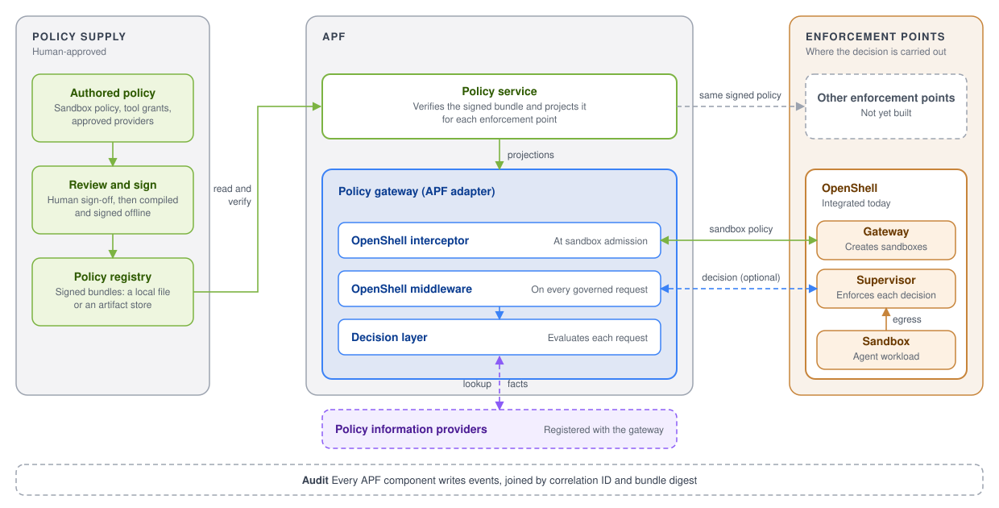
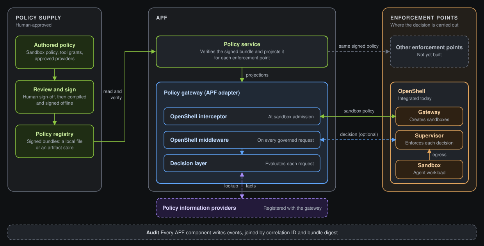

APF governs what agents may do in two ways. It projects signed policy into the runtime's own controls, so a sandbox is built from policy the enterprise approved, and it decides each governed request the runtime hands it, so a call that the sandbox allows can still be denied or edited for what it carries.

- **Signed policy, projected.** A bundle is authored, reviewed, and signed outside APF. The policy service verifies it and compiles it into the form each enforcement point consumes. The runtime applies that projection when it creates a sandbox, and refuses edits that bypass it.
- **Decisions on request.** The policy gateway evaluates each governed request against the same signed policy, with facts from registered providers when it needs them, and returns allow or deny with any edits. The runtime carries the decision out.

Policy flows one way. The **policy service** reads a signed bundle from a registry, verifies it, and serves projections. The **policy gateway** fetches those projections and hosts the adapters that face the runtime: an **OpenShell interceptor** that hands OpenShell its sandbox policy at admission, and an **OpenShell middleware** that returns a decision for each request OpenShell routes to it. **OpenShell** builds the sandbox and enforces. Every APF component writes **audit** events, joined by a correlation ID and the digest of the bundle that decided.

## Components

| Component | What it does |
|---|---|
| [Signed bundle](../manage-policy-bundles/bundle-structure.mdx) | The unit of policy: a signed manifest of YAML documents for the sandbox perimeter, approved providers, tool grants, detectors, effects, and findings. Authored and signed outside APF. |
| [`apf-compile`](../reference/cli-commands.mdx) | The offline CLI. Compiles and signs a bundle from a manifest template, and verifies a signed bundle. It runs in the authoring and publish path, not on the host. |
| [Policy service](../how-it-works/policy-service.mdx) | Reads the bundle from a local file or an HTTPS source, verifies its signature, member digests, validity window, and revision counter, projects it for each enforcement point, and serves the projections with a signed provenance token. It never evaluates a request and cannot author or sign policy. |
| [Policy gateway](../how-it-works/policy-gateway.mdx) | The APF adapter that faces the runtime. Fetches the policy set, builds the evaluator, swaps in a new one when the bundle changes, and hosts the OpenShell interceptor and the OpenShell middleware. |
| [OpenShell interceptor](../integrations/openshell/gateway-interceptor.mdx) | Runs inside the gateway at sandbox admission. Injects the projected sandbox policy, stamps provenance onto the sandbox, validates it before OpenShell admits the sandbox, pushes bundle-managed provider profiles when configured, and refuses policy and provider changes that bypass the bundle. |
| [OpenShell middleware](../integrations/openshell/supervisor-middleware.mdx) | Runs inside the gateway on each request OpenShell routes to it, before credentials are added. Builds the evaluation input, runs the evaluator, and returns allow or deny with body patches, header changes, and findings. |
| [Decision layer](../how-it-works/request-evaluation.mdx) | The evaluator the gateway runs in process: enrichment from providers, annotators, Cedar rules, and effects. An evaluation error is a deny. |
| [Policy information providers](../integrations/policy-information-providers.mdx) | Processes outside APF that an operator registers with the gateway. They attest facts the request does not carry, such as whether a change is approved, and never decide. |
| [OpenShell](../integrations/openshell/index.mdx) | The enforcement point integrated today. Its gateway creates sandboxes from the projected policy, and its supervisor enforces each decision on egress. Refer to [How Enforcement Points Attach](#how-enforcement-points-attach). |
| [Audit log](../observability/access-audit-events.mdx) | One schema-validated JSONL file per component, recording verification, activation, admission, each decision, and each refused caller. |

In the standard policy vocabulary, the policy service is the administration point, the policy gateway is the decision point, providers are information points, and the runtime is the enforcement point. Refer to the [Glossary](../resources/glossary.mdx). Each role is held by a different party, so no component can both write policy and enforce it.

The repository is a Rust workspace. The two services, `apf-policy-service` and `apf-policy-gateway`, are the only long-running processes; the OpenShell adapters are libraries linked into them, with the projector in the policy service and the OpenShell interceptor, OpenShell middleware, and caller authentication in the gateway. OpenShell-specific code lives in the `apf-openshell-*` crates, so a second enforcement point adds its own adapters without changing the shared libraries. Refer to [APF Adapter](../integrations/apf-adapter.mdx). Tool invocation and credential handling are outside APF.

## Trust Boundary

The signing authority, the policy service, the policy gateway, and the runtime each hold one job, and the boundaries between them are what the design protects. Authority sits with whoever holds the signing key. The services that read and enforce a bundle cannot change it, and the runtime that applies a decision cannot make one.

| Guarantee | How APF provides it | What the enforcement point gets |
|---|---|---|
| Only signed policy takes effect | The policy service verifies the signature against its trust roots, every member digest, and the validity window, and refuses a revision lower than the highest it has accepted. The counter is stored on disk and survives a restart. | Projections built only from a bundle that passed every check. The runtime never sees the raw bundle. |
| Policy cannot be changed on the host | The OpenShell interceptor refuses direct policy edits, approval-mode changes, and provider changes that did not come from the bundle. | A sandbox whose policy is the projection, with no side door. |
| Every sandbox carries proof of its policy | The OpenShell interceptor stamps the bundle ID, revision, document digest, signer, and a provenance token signed by the policy service, then validates them before admission. | Annotations anyone can verify against the policy service's published key, without trusting the host. |
| Every decision names its policy | Each audit record carries the bundle digest and revision, a correlation ID, and one provenance entry per provider consulted. | A trail that joins its own logs to APF's by correlation ID. |
| Failure closes, not opens | Admission fails when the projection cannot be fetched or verified. An evaluation error is a deny. A request that is too large or malformed is denied. A provider registered to fail closed that cannot answer denies the request. | A refusal with a reason, never an unchecked request. |
| A bad bundle never replaces a good one | The gateway keeps the last evaluator it built if a fetch or build fails, and a bundle that expires or regresses is refused at ingest. | Continuity on the last verified policy. |

### How a Request Travels

1. At creation, OpenShell asks the OpenShell interceptor for the sandbox's policy. The interceptor fetches the projection, injects it, and stamps provenance. A later validate step checks the stamp before OpenShell admits the sandbox.
2. OpenShell enforces its own layer first: reachable destinations, permitted tools and methods, from the projection. A request that fails here never reaches APF.
3. If the request is routed to APF, OpenShell sends it to the OpenShell middleware before adding credentials, so APF evaluates a credential-free request.
4. The decision layer looks up facts from registered providers, runs annotators, evaluates the Cedar rules, and applies effects.
5. The OpenShell middleware returns allow or deny with any edits. OpenShell rejects the request or applies the edits and forwards it. Both sides write an audit record.

Refer to [The Governed Path](governed-path.mdx) for each layer in detail.

## Evaluation Pipeline

Up to four stages run on each governed request. If providers are registered, Enrichment looks up their facts first and exposes them to rules as `context.<domain>`. Annotators then inspect the request and set named signals, Cedar rules decide from those signals and facts together with the request's subject, tool, arguments, and target, and effects apply the edits and findings an allowing rule names. An evaluation error is a deny. Refer to [Request Evaluation](../how-it-works/request-evaluation.mdx).

## Control Plane and Data Plane

APF's control plane distributes policy. Its data plane decides requests.

| | Control plane | Data plane |
|---|---|---|
| What flows | Signed bundles and their projections. | Agent requests and decisions. |
| Initiator | The authoring and publish path delivers a bundle to the policy service. The policy gateway polls the policy service. | Agent to OpenShell to the policy gateway. |
| Latency tolerance | Seconds to minutes, in the background. | Per request, in process. In the current deployment, there is no network hop to the policy service. |
| Remote dependency | The policy service may fetch bundles over HTTPS. | Registered policy information providers only, each under a budget and a declared failure mode. None without a registration. |
| Failure mode | The gateway keeps the last evaluator it built if a refresh fails. | Deny-safe. An evaluation error on the OpenShell path is a deny. `EvaluationService` returns an `INTERNAL` error instead, which its caller must treat as a deny. A provider registered to fail closed that cannot answer denies on both surfaces. |

Both OpenShell seams sit on APF's data plane. At admission APF serves a projection, and per request APF serves a decision. Neither seam distributes policy.

## How Enforcement Points Attach

Every enforcement point follows the same contract: it receives APF's policy in its own native form, it applies that policy itself, and it carries out each decision APF returns. It never decides on its own.

| Enforcement point | How it receives policy | How it receives decisions | Status |
|---|---|---|---|
| OpenShell | The OpenShell interceptor injects the projected sandbox policy at admission. When the gateway is configured with the OpenShell gateway's address, it also pushes bundle-managed provider profiles and, after a bundle change, asks OpenShell to refresh each running sandbox. | The OpenShell middleware, on each request OpenShell routes to it, before credentials are added. Routing is OpenShell's choice; once a request arrives, it is always evaluated. | Integrated today. |
| A new enforcement point | A projector in the policy service lowers the bundle into its native form. | An adapter in the policy gateway serves its hooks. | Extension point available. No second enforcement point ships. |

**OpenShell owns** the sandbox lifecycle, the network namespace, extension registration, trusted service CAs, credential injection, and authenticating itself to APF. **APF owns** which policy applies, whether a request is permitted, which edits apply, and the trust anchor it uses to authenticate OpenShell as a caller. Refer to [OpenShell Integration](../integrations/openshell/index.mdx).

## How Components Authenticate

Each connection has its own credential, and the three trust anchors are separate: the trust roots that verify bundles, the document signing key that signs provenance tokens, and the OpenShell extension trust profile that authenticates OpenShell's calls. None can stand in for another.

| Connection | Who connects | How it is protected |
|---|---|---|
| OpenShell gateway to OpenShell interceptor | The OpenShell gateway dials the interceptor listener at sandbox admission. | TLS on the listener and a short-lived OpenShell extension JWT. Only the gateway caller is accepted. |
| OpenShell supervisor to OpenShell middleware | A sandbox supervisor dials the middleware listener per request. | TLS and an extension JWT bound to one sandbox. The sandbox in the token must match the sandbox in the request. |
| Policy gateway to policy service | The gateway polls for the policy set and fetches projections. | A Unix domain socket, mode `0600`. The policy service accepts only the configured peer UID, which defaults to its own. |
| Co-located callers to the gateway | A process on the same host calls `EvaluationService`. | A Unix domain socket, mode `0600`. The gateway accepts only the configured peer UID, which defaults to its own. |
| Policy gateway to providers | The gateway looks up facts in the Enrichment stage. | Mutual TLS with a pinned CA and a client certificate, or a Unix socket with a peer-UID check. A JSON API is called over HTTPS with a credential read from a file. |
| Operators to the policy service | Health probes, the gateway's key fetch, and operators use the HTTP surface. | Off by default. When enabled, health routes are open and the document and refresh routes require a bearer token. |
| Anyone to a provenance token | A sandbox's token is verified against the policy service's published key set. | EdDSA signature. The key set is served over the HTTP surface. |

The gateway checks the trust profile, certificate, and key files before a listener reports ready, and refuses a listener with a partial set. For local research only, a listener can opt out of TLS and caller authentication with an explicit flag. Refer to [Configure Service Authentication](../deployment/configure-service-authentication.mdx), [Trust Boundaries](../security/trust-boundaries.mdx), and [Service APIs](../reference/service-apis.mdx).

## Working With Your Existing Infrastructure

APF does not prescribe the systems around it. Bring your own signing authority: the policy service accepts Ed25519 and ECDSA P-256 trust roots. Keep bundles where you keep other artifacts: a local file or any HTTPS source the service can poll. Register the systems of record you already run as providers, so rules read facts from them without code changes. Ship the audit files with your own log collector. A new runtime attaches through an adapter pair and leaves the policy model unchanged. Refer to [External Policy Authorities](../integrations/external-policy-authorities.mdx), [Policy Information Providers](../integrations/policy-information-providers.mdx), [Export Audit Events](../observability/export-audit-events.mdx), and [APF Adapter](../integrations/apf-adapter.mdx).

## Next Steps

- To follow one action across both seams, refer to [The Governed Path](governed-path.mdx).
- To see how the services are deployed today, refer to [Deployment Models](../deployment/deployment-models.mdx).
- To review what each boundary protects, refer to [Trust Boundaries](../security/trust-boundaries.mdx).
- To check which capabilities are available today, refer to [Support and Compatibility](support-and-compatibility.mdx).
