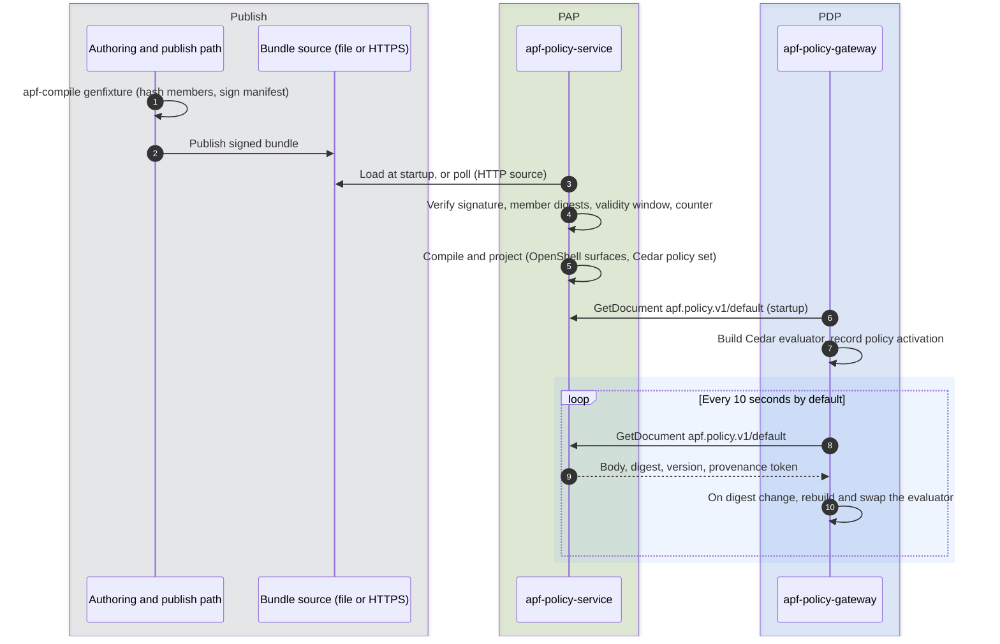
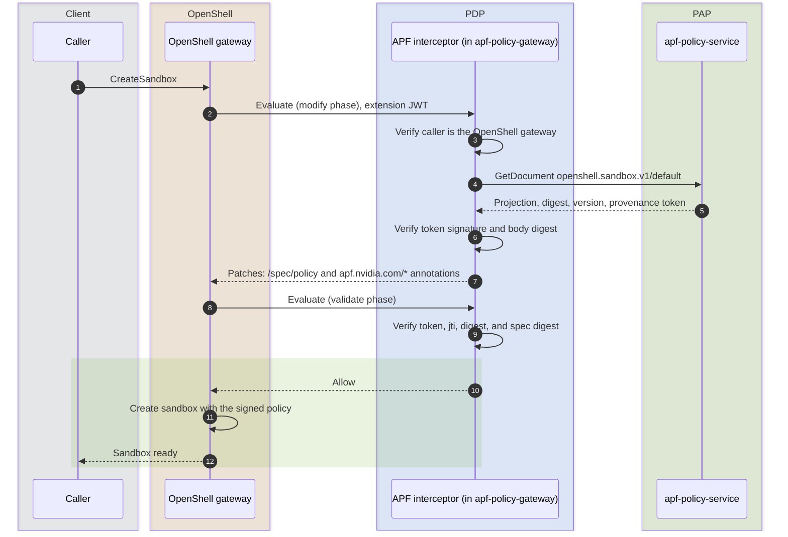
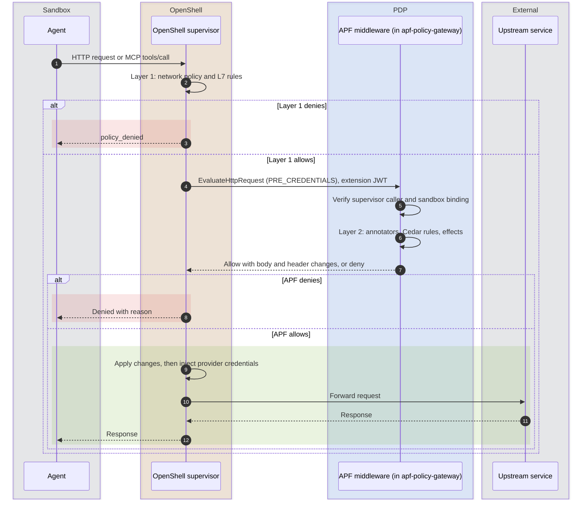

An agent gets one path to the outside world, and it is the same path every time. Before the agent runs, its sandbox is set up from a policy that Security signed off on. From then on, every action the agent tries, such as posting a message, opening a pull request, or calling an API, has to clear a series of checks before it happens. Failing any check stops the action.

## Who Does What

The enterprise authors the rules, APF verifies and decides, and the runtime does the physical work.

| Step | Enterprise teams | APF | Runtime |
|---|---|---|---|
| Author and sign | Author, review, and sign policy offline. | Provides `apf-compile`, the bundle format, and the signature scheme. | |
| Verify and serve | | `apf-policy-service` verifies the signature, member integrity, validity window, and revision counter, then serves projections. | |
| Admission | | Injects the `SandboxPolicy` projection and stamps provenance onto the sandbox. | Applies the projection: network, filesystem, and process controls. |
| Layer 1, containment | | Configured from APF's projection. Not on the call path. | Enforces reachable destinations and permitted methods on every call. |
| Layer 2, capability grants, content, and context | | `apf-policy-gateway` evaluates the call and returns a decision and mutations. | Rejects the call, or applies the returned body and header changes. |

## Policy Delivery

Policy reaches the decision point before any sandbox is admitted. The policy service verifies a bundle once, when it ingests it. The gateway trusts what it reads over the local socket and swaps its evaluator when the served policy changes.

Refer to [Verify and Activate](/manage-policy-bundles/verify-and-activate) for each check and its rejection reason.

## Sandbox Admission

Admission is the one-time gate at sandbox creation. It decides what the sandbox may run as and pins the exact policy version it was admitted under, so the sandbox's containment policy can be traced back to the bundle it came from.

Admission spans two OpenShell interceptor phases on `CreateSandbox`.

1. **Modify.** APF fetches the pre-compiled `SandboxPolicy` projection from the policy service, verifies the provenance token that comes with it, checks that the body digest matches the token, and returns RFC 6902 patches. The patches set `/spec/policy` to the signed projection, overwriting any policy in the request, and add `apf.nvidia.com/*` provenance annotations.
2. **Validate.** APF reads the annotations back, verifies the provenance token again, confirms the token's `jti` and document digest match the annotations, and recomputes the sandbox policy spec digest to detect any change made after injection.

No policy lowering happens at admission. The projection was compiled when the policy service loaded the bundle. If the projection cannot be fetched or fails verification, admission fails closed.

Refer to [Sandbox Admission](/how-it-works/sandbox-admission) for the annotations and denial reasons.

## Per-Action Layers

Once a sandbox is admitted, every action travels the same layers. Each layer is a distinct check run by a distinct component against a distinct input.

- **Layer 1** runs inside the sandbox runtime against the projection fixed at admission: `network_policies`, `filesystem`, `landlock`, and `process`, plus the provider profiles that name reachable services. It checks the destination, the method and path, and the calling binary. For GraphQL, JSON-RPC, and MCP endpoints it also reads the operation in the body, such as an MCP tool name. No APF evaluation happens here.
- **Layer 2** runs inside `apf-policy-gateway`. OpenShell's supervisor calls APF's middleware at the `PRE_CREDENTIALS` hook. APF builds an evaluation input from the request target, body, and any MCP tool call, runs the annotator, Cedar, and effect stages, and returns a decision.

The order follows cost and specificity. Layer 1 is a static policy check that rejects out-of-policy traffic before APF is called. A call reaches Layer 2 only if Layer 1 allowed it and the sandbox policy selects APF's middleware for the destination host.

The Layer 2 decision is an in-process call on the evaluator the gateway built from the active policy set. It is not a network hop to the policy service.

Layer 2 never sees provider credentials. The `PRE_CREDENTIALS` hook fires after OpenShell's Layer 1 checks and before OpenShell injects provider credentials, so APF evaluates every request without the credentials OpenShell adds. Secrets the agent itself put in a request are visible, which is what APF's secret detectors look for.

## How Running Sandboxes Pick Up a New Policy

A new bundle reaches per-request evaluation as soon as the gateway notices that the served policy set changed and swaps its evaluator. Refer to [Hot Swap](/how-it-works/policy-gateway#hot-swap) for when that can be delayed. The containment projection inside a running sandbox changes only when OpenShell processes an `UpdateConfig` for that sandbox.

When the gateway is started with `--openshell-gateway-url` and `--jwks-url`, and bundle refresh is enabled, its sandbox policy refresher sends a bare `UpdateConfig` to each Ready or Provisioning sandbox in the default workspace when the served policy set changes. APF's interceptor injects the newly served policy and provenance into that request. The trigger is a change to the bundle's rules, annotators, effects, or findings. A bundle that changes only the sandbox policy does not trigger a refresh. OpenShell rejects the whole update if the new sandbox policy changes a field it fixes at creation, such as `process` or `landlock`. Without those flags, running sandboxes keep their admitted projection, and new sandboxes receive the new projection at admission.

Refer to [Update Policies](/manage-policy-bundles/update-policies) for the full update procedure.

## Next Steps

- To see each component's role in detail, refer to [How It Works](/how-it-works/policy-service).
- To write the rules evaluated at Layer 2, refer to [Policy Model](/author-policies/policy-model).
- To walk the path yourself, refer to [Your First Governed Agent](/get-started/your-first-governed-agent).
