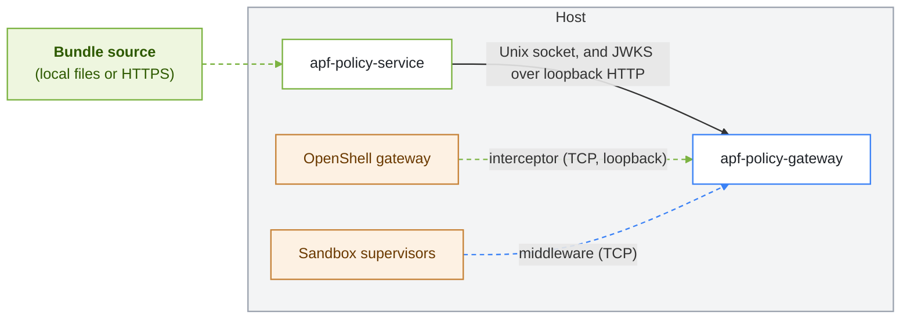

APF runs as two services on the same host as the OpenShell gateway it governs. This page describes the supported topology and the packaging options for it.

## Co-Located Deployment

`apf-policy-service` and `apf-policy-gateway` run on the same host and share a Unix domain socket. The policy service verifies, projects, and serves bundles over that socket, and the gateway fetches from it locally. When the interceptor is enabled, the gateway also fetches the policy service's provenance verifying key from its JWKS endpoint over loopback HTTP. The bundle source, a local directory or a remote artifact store, is independent of the topology.

This is the supported topology in this release. The gateway fetches documents from the policy service only through a Unix socket, so the two must share a host, and in a container deployment they must share the socket volume.

## Packaging Options

| Option | Status | Use it for | Reference |
|---|---|---|---|
| systemd services on a Linux host | Available | Workstations and hosts that run OpenShell natively. | [Host and Workstation Deployment](host-and-workstation-deployment.mdx) |
| Container images | Available | Building your own container deployment. Each Dockerfile has a minimal `runtime` target. | `deploy/docker/apf-policy-service/Dockerfile`, `deploy/docker/apf-policy-gateway/Dockerfile` |
| Local container stack | Development only | Local development with Docker Compose. | [Installation](../get-started/installation.mdx) |
| Kubernetes | Limited | Cluster deployments with the Helm chart at `deploy/helm/apf`. You build and load the images yourself. | [Kubernetes](kubernetes.mdx) |

The policy service image also has a `demo` target that adds `apf-compile` for signing bundles inside the container.

## Placement Rules

- **One policy service per gateway.** Each policy service keeps its own anti-rollback counter on local disk, and each gateway reads one policy service socket.
- **Same account on systemd hosts.** Both daemons create their sockets with mode `0600` and check the peer's UID, so they run as the same `apf` account.
- **Loopback for OpenShell surfaces on a host.** In the co-located host topology, bind the interceptor and middleware listeners to loopback unless OpenShell's supervisors run in a separate network namespace that cannot reach loopback. On Kubernetes the chart binds the listeners it enables on all pod interfaces and exposes them through the APF Service, because the OpenShell gateway and the supervisors run in other pods; limit the callers with the chart's `networkPolicy` values.
- **Reachability for supervisors.** The middleware listener must be reachable from every sandbox supervisor, which depends on the OpenShell compute driver. Choose the bind address to match. On systemd hosts the gateway unit also sets `IPAddressAllow=localhost` and `IPAddressDeny=any`, so change the unit as well if supervisors connect from outside loopback.

## Shared Policy Service

The policy service is yours to run, and in this release it runs beside each gateway. A shared `apf-policy-service` that many gateways fetch from over the network is not in the repository: the gateway fetches documents only over a Unix socket, and each policy service keeps its anti-rollback counter on local disk, so every host runs its own policy service alongside its gateway.

## Next Steps

- To install on a host, refer to [Host and Workstation Deployment](host-and-workstation-deployment.mdx).
- To review the boundaries in this topology, refer to [Trust Boundaries](../security/trust-boundaries.mdx).
