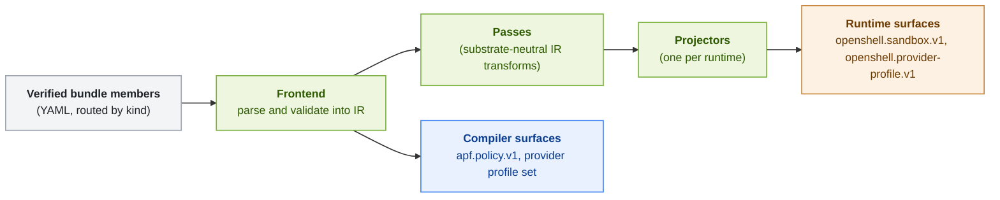

Projection turns the policy an enterprise authored into the form each enforcement surface understands. One signed bundle can feed several surfaces: the runtime's sandbox configuration, the runtime's provider catalog, and APF's own decision engine. Each surface gets only the part of the policy it can enforce.

Projection happens once, when the policy service loads a bundle. Nothing is lowered at sandbox admission or on the request path. The interceptor fetches documents that were already projected. The gateway builds its Cedar evaluator from the served policy set, and the interceptor converts provider profile YAML to OpenShell's format when it reconciles profiles.

## Compilation Pipeline

The compiler in `apf-compiler` runs three stages on the verified bundle members.

1. **Frontend.** Each member is routed by its `kind` and parsed into APF's canonical intermediate representation, which mirrors the protobuf contracts in `contracts/proto/`. The frontend rejects unknown `spec` fields, a `PolicyRule` whose `language` is not `cedar`, and a `data` block that is not a mapping. A member whose `kind` is not recognized is skipped without an error, unknown `metadata` keys are allowed, and passthrough `ProviderProfile` documents are not parsed.
2. **Passes.** Substrate-neutral transforms over the IR. The pass pipeline is empty in this release.
3. **Projectors.** Each registered projector lowers the aggregate IR to one runtime's native surfaces. The policy service registers the OpenShell projector.

The compiler also emits two surfaces itself, independent of any projector: the `apf.policy.v1` policy set and the `openshell.provider-profile.v1/default` profile set.

## Surfaces

| Surface | Produced by | Contents |
|---|---|---|
| `apf.policy.v1/default` | Compiler | Every `PolicyRule`, `PolicyAnnotator`, `PolicyEffect`, and `PolicyFinding` in manifest order, as one protobuf `PolicySet`. One document, one provenance token, one consistent snapshot. |
| `openshell.provider-profile.v1/default` | Compiler | A protobuf `ProviderProfileSet` of the bundle's `ProviderProfile` members. |
| `openshell.sandbox.v1/<name>` | OpenShell projector | One OpenShell `SandboxPolicy` protobuf per APF `SandboxPolicy`, keyed by `metadata.name`. |
| `openshell.provider-profile.v1/<name>` | OpenShell projector | One OpenShell provider profile YAML document per `Provider` or `ProviderProfile` member. |
| `apf.policy-rules.v1`, `apf.policy-annotators.v1`, `apf.policy-effects.v1`, `apf.policy-findings.v1` | OpenShell projector | JSON arrays of the compiled documents of each kind, emitted only when the bundle has at least one. The rules array omits `role`. No APF component consumes them. |

## OpenShell Sandbox Policy

The OpenShell projector lowers each APF `SandboxPolicy` to the OpenShell `SandboxPolicy` protobuf at the pinned OpenShell version. The two schemas are structurally aligned. The differences are:

- APF documents are nested as `metadata` and `spec`. The OpenShell target is flat and carries a schema `version` of `1`.
- Endpoint `tls`, `enforcement`, and `access` are authored as strings and projected as OpenShell enums. An unknown value is a projection error, so the bundle does not load. `tls: terminate` and `tls: passthrough` project successfully, but OpenShell 0.1.x rejects them at admission.
- `landlock.compatibility` is passed through as a string without a check. OpenShell accepts `best_effort` and `hard_requirement`.
- MCP `versions` are left empty, each middleware entry's `config` is left unset, and endpoint request-signing fields are left empty.
- APF sets OpenShell's internal `advisor_proposed` field to `false` on every endpoint. Policy authors never set it.
- `network_middlewares` entries are projected into the OpenShell policy's `network_middlewares` map, which is how OpenShell selects APF's middleware for the listed hosts.
- Endpoint `credential_binding` is always projected as unset, and `allow_uninspected_credentials` as `false`.
- Binary `harness` flags are not projected.

## OpenShell Provider Profiles

An APF `Provider` document is composed into an OpenShell provider profile YAML document.

| `Provider` field | Provider profile field |
|---|---|
| `metadata.name` | `id` |
| `metadata.title` | `display_name` |
| `metadata.description` | `description` |
| `spec.type` | `category`. `inference`, `agent`, `source-control`, `messaging`, `data`, and `knowledge` map to the OpenShell category of the same meaning. Any other value maps to `other`. |
| `spec.type` of `inference` or `agent` | `inference_capable: true`. |
| `spec.endpoints` | `endpoints`. |
| `spec.binaries` | `binaries`, as paths. |
| `spec.credentials` | `credentials`, with `auth_style`, header, query parameter, or path template, and a refresh or token grant block derived from the credential `source`. |
| Credentials not marked `discoverable: false` | `discovery.credentials`. |

A bundle may also carry OpenShell-native provider profiles, either as `kind: ProviderProfile` documents or as profiles with a top-level `id` and `endpoints` and no `kind`. These pass through unchanged. If a `Provider` and a passthrough profile share a name, the composed `Provider` wins.

Refer to [Credential Integration](credential-integration.mdx) for how credential sources are projected.

## What Is Not Projected

- `HostTool` documents are recognized when a bundle is loaded, but no surface is built from them in this release.
- No projector emits OpenShell OPA or Rego policy. Cedar policy ships to APF's own evaluator as source in `apf.policy.v1`, and OpenShell receives only its declarative sandbox policy and provider profiles.

## Adding a Runtime

A new runtime needs a new projector that implements the `Projector` trait from `apf-compiler` and is registered with the compiler in the policy service. The frontend, the passes, and the other projectors do not change. Refer to [APF Adapter](../integrations/apf-adapter.mdx).

## Next Steps

- To see how the sandbox projection reaches OpenShell, refer to [Sandbox Admission](sandbox-admission.mdx).
- To author the documents that are projected, refer to [Sandbox Policies](../author-policies/sandbox-policies.mdx).
