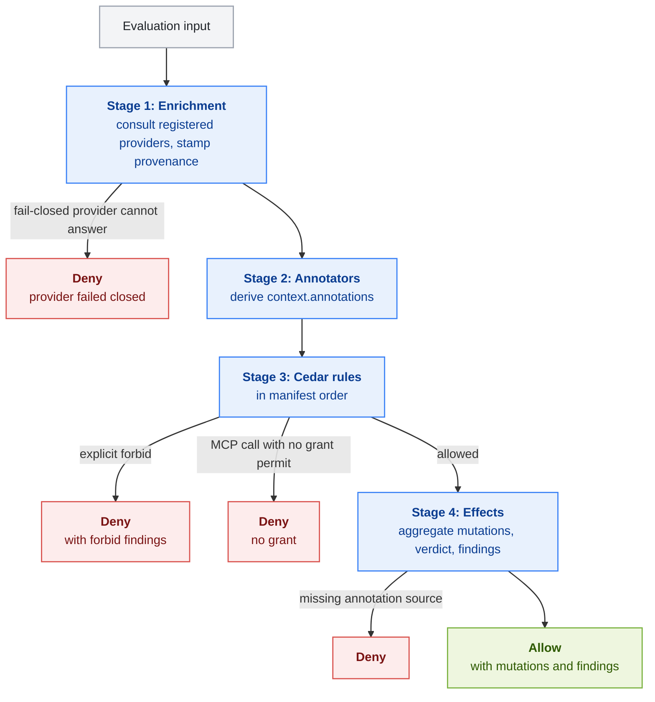

Request evaluation is Layer 2 of the governed path. OpenShell's sandbox supervisor sends each egress request that the sandbox policy routes to APF's middleware, after its own Layer 1 checks and before it injects credentials. APF decides in process and returns a decision. OpenShell enforces it.

## From Request to Evaluation Input

The middleware accepts only the `HTTP_REQUEST` operation at the `PRE_CREDENTIALS` phase. Before it builds an evaluation input, it checks the request and denies it with a stable reason code if a check fails.

| Check | Reason code on failure |
|---|---|
| The phase is `PRE_CREDENTIALS`. | `invalid_phase` |
| The middleware `config` from the sandbox policy is empty. | `invalid_config` |
| The body is at most 4 MiB. | `body_too_large` |
| A body that looks like an MCP `tools/call` parses as JSON with a string `params.name` and an object `params.arguments`, if present. | `invalid_mcp_request` |
| A JSON-RPC batch does not contain a `tools/call`. | `invalid_mcp_request` |
| The request has a target. | `missing_target` |

The evaluation input has these fields:

| Field | Source |
|---|---|
| `tool` | `params.name` of an MCP `tools/call` JSON-RPC body. Absent for other requests. |
| `capability` | Not set by the OpenShell middleware. |
| `user_subject` | Empty. OpenShell does not supply an authenticated user subject on this path. |
| `args` | `params.arguments` of an MCP `tools/call`. Empty for other requests. |
| `body_text` | The request body as text. Invalid UTF-8 bytes are replaced so the rest stays visible to detectors. |
| `body_json` | The parsed body when it is JSON. |
| `target` | Host, method, path, and scheme of the request. |
| `has_tool_name` | `true` when the request is an MCP tool call. |
| `runtime` | The sandbox id from the request context, as an `openshell` runtime identity. In authenticated mode the supervisor's token attests it. With the insecure transport flag it is only asserted by the caller. |
| `context_attributes` | Empty. The Enrichment stage fills it from registered providers, and anything a caller supplies is discarded. |

APF identifies an MCP tool call from the request body, not from the destination. Any JSON body whose `method` is `tools/call` is evaluated as a tool call.

## Cedar Request Mapping

Each request is mapped to a Cedar principal, action, and resource.

| Slot | Value |
|---|---|
| `principal` | `APF::User::"<user_subject>"`. On the OpenShell middleware path the subject is empty. |
| `action` | `APF::Action::"<tool>::<capability>"` when both are set, `APF::Action::"<tool>"` when only the tool is set, otherwise `APF::Action::"invoke"`. On the OpenShell middleware path an MCP call maps to `APF::Action::"<tool name>"`. |
| `resource` | `APF::Tool::"<tool>"`, or `APF::Tool::"__none__"` for a request without a tool. |

The Cedar context is a record with these attributes:

| Attribute | Type | Contents |
|---|---|---|
| `body_text` | String | The request body as text. |
| `has_tool_name` | Bool | Whether the request is an MCP tool call. |
| `target_host`, `target_method`, `target_path`, `target_scheme` | String | The request target. Present when the request has a target. |
| `args` | Record | Tool arguments. For each string argument `x`, APF also adds `x_len`, its length in characters, and `x_num`, its integer value when it parses as one. JSON nulls are dropped. |
| `annotations` | Record | Values produced by the annotator stage. |
| `data` | Record | The evaluating rule's own `spec.data` block. Each rule sees only its own data. |
| `<domain>` | Record | Facts from the policy information provider registered for that domain, plus its `_meta` provenance record. One record per registered domain. Refer to [Policy Information Providers](../integrations/policy-information-providers.mdx). |
| `<domain>._meta` | Record | Provenance for the domain: `provider`, `verified`, `age_seconds`, `degraded`, `cached`, `status`, and `evidence_ref`. A record whose provider degraded or supplied nothing holds only `_meta`. |

APF evaluates Cedar with an empty entity store. Conditions read from the context, not from entity attributes or hierarchies.

A provider domain can never be `args`, `annotations`, `data`, `body_text`, `has_tool_name`, `target_host`, `target_method`, `target_path`, or `target_scheme`. The gateway rejects such a registration, and the evaluator refuses an input whose namespace would shadow one of those roots.

## The Four Stages

Without registered providers the Enrichment stage does nothing, and the pipeline is the annotator, Cedar, and effect stages alone.

### Stage 1, Enrichment

Before the evaluator runs, the gateway consults the policy information providers registered with `--pip-config` and writes their facts into the context. Refer to [Policy Information Providers](../integrations/policy-information-providers.mdx) for the registration file and the provider contract.

- A provider is consulted when it applies to the request. `applies_to` lists tool names or action ids, and an entry matches when it equals the request's tool name or its action id. On the OpenShell path both are the bare MCP tool name. On the `EvaluationService` path the tool name is `resource.class` and the action id is `<resource.class>::<verb>`. One entry covers both surfaces only when callers use the same tool name on both; otherwise list both forms. A registration without `applies_to` is consulted on every evaluation.
- The gateway sends each applicable provider only what its type allows, the identity and action fields of the subject to a `grpc` provider and the request fields its lookup keys read to an `http` provider. It looks the facts up within the provider's `timeout_ms`, validates the answer, and writes it to `context.<domain>` together with a `_meta` provenance record. The whole stage runs under `--pip-stage-budget-ms`, 250 ms by default.
- When a provider cannot answer, its registered failure mode decides. With `fail_closed` the request is denied before any rule runs, with the reason `pip_<status>:<provider>`, for example `pip_timeout:change-management`. With `degrade` the domain's record holds only `_meta`, with `degraded` set to `true` and `status` naming the failure, and evaluation continues.
- A failure the caller caused, such as a projected subject over the message size cap or a correlation id over 256 bytes, is `pip_invalid_input` and denies regardless of the failure mode.
- Any `context_attributes` a caller supplies are discarded before the stage runs. Only the gateway writes provider facts.

The statuses are `found`, `no_data`, `not_applicable`, `timeout`, `unavailable`, `capacity`, `invalid_output`, `invalid_input`, `unauthorized`, `misconfigured`, and `internal`. The first three are not failures.

Write permits over provider facts with a `has` guard, so a missing fact leaves the grant off. A forbid that reads a missing provider fact fails to evaluate and denies the request, as described under [Stage 3](#stage-3-cedar-rules).

### Stage 2, Annotators

Every annotation in every `PolicyAnnotator` runs against the raw input. Annotators cannot see each other's output, and an annotation name may be defined only once in a bundle.

- A `bool` annotation is always present in `context.annotations`. It is `false` when its rules do not match.
- A `string` or `integer` annotation is present only when a rule produced a value. Guard reads with `context.annotations has <name>`.

### Stage 3, Cedar Rules

Each `PolicyRule` is its own Cedar policy set, evaluated in bundle manifest order with its own `data` in the context.

- An explicit `forbid` that fires stops evaluation. The request is denied with the reason `<rule>/<@id>`, or the `@id` itself when it contains `/`, or `<rule>/policyN` when the statement has no `@id`. The findings referenced by that forbid's `@apf_finding` are attached.
- A rule where no statement matches is skipped. Cedar's default deny does not deny the request.
- A `forbid` that fails to evaluate, for example because it reads an attribute the request does not carry, denies the request with the reason `<rule>/<@id>: evaluation error`. The engine's error text is written to the gateway log, not returned to OpenShell. If another `forbid` in the same rule fires on the request, that `forbid` decides and the erroring one is logged. This includes a forbid that reads a provider fact the Enrichment stage did not supply. A `permit` that fails to evaluate grants nothing. Guard optional attributes with `has` when a statement should simply not apply.
- A `permit` that fires contributes its `@apf_effect` and `@apf_finding` references.
- A rule's `role` decides whether its permits count as a grant. Every MCP tool call needs at least one permit from a `capability` rule. A `control` rule's permit does not count. A request that is not a tool call needs no grant.

When an MCP tool call gets no grant, the deny reason is `<rule>: conditions not met for <action>` if a capability rule whose name contains the full tool name was skipped, and `no grant for <action>` otherwise. On the OpenShell path the tool name is the whole MCP tool name, such as `github_repo_write`, so most denials read `no grant for <action>`.

### Stage 4, Effects

On an allow, the effects referenced by every fired permit are aggregated in firing order.

- Body patches accumulate and apply in order with RFC 6902 semantics.
- A body replacement is last-wins and takes precedence over patches.
- Header mutations accumulate in order.
- The verdict is the strongest one that fired: `allow`, then `warn`, then `escalate`.
- The `reason` and `message` come from the first fired effect that carries the final verdict.
- Findings from effects come first, in firing order, followed by the findings from fired permits' `@apf_finding` references.

A `source` or `label_source` that names an annotation the request did not produce fails the whole evaluation closed, and the request is denied.

## Applying the Result

The middleware turns an allow into concrete changes before it answers OpenShell. Any failure is a deny, because forwarding an unmodified request would drop a mandated change.

| Rule | Failure reason code |
|---|---|
| A body replacement becomes the new body. The rewritten body, from a replacement or from patches, must not exceed 4 MiB. | `replacement_body_too_large` |
| Body patches require a JSON body, and a `replace` or `remove` on a missing path is an error. | `effect_application_failed` |
| A `set` or `add` header mutation must name a header that starts with `x-openshell-middleware-`. | `invalid_header_mutation` |
| A `remove` header mutation must not name a protected header such as `authorization`, `cookie`, `host`, `content-length`, or any `x-openshell-credential*` or `x-amz-*` header. | `invalid_header_mutation` |
| At most 64 header mutations, 32 KiB of header names and values, and 64 KiB of encoded mutations. At most 32 findings, including the extra `policy_verdict` finding, each at most 4 KiB encoded. | `invalid_header_mutation`, `invalid_findings` |

An evaluation error returns `evaluation_failed`. The engine's error text is not returned to OpenShell.

## The Response to OpenShell

| Decision | Response |
|---|---|
| Allow | `ALLOW`, the new body if one was produced, header mutations, and findings. A `warn` or `escalate` verdict travels as an extra finding of type `policy_verdict`, because the OpenShell wire has no verdict field. |
| Policy deny | `DENY` with reason code `policy_denied`, the deny reason truncated to 4 KiB, and the forbid's findings. A fail-closed provider denial from the Enrichment stage uses the same reason code with the reason `pip_<status>:<provider>`. |
| Adapter deny | `DENY` with one of the reason codes above. |

OpenShell blocks a denied request or applies the changes, and only then injects provider credentials and forwards the request. Every decision writes one `authorization` record to the middleware audit file. When providers are registered, the record carries an `extensions.x_apf_pip` object listing what each provider contributed. Refer to [Understand Decisions and Findings](../observability/understand-decisions-and-findings.mdx).

## Next Steps

- To write rules for this pipeline, refer to [Policy Model](../author-policies/policy-model.mdx).
- To see the middleware contract, refer to [Supervisor Middleware](../integrations/openshell/supervisor-middleware.mdx).
- To register providers for the Enrichment stage, refer to [Policy Information Providers](../integrations/policy-information-providers.mdx).
