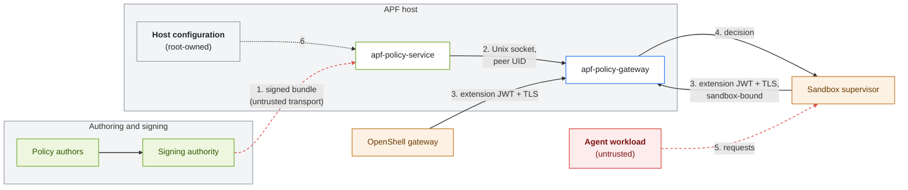

APF's security rests on a small number of boundaries. At each one, a component accepts input from another and either verifies it or trusts it for a stated reason. Knowing which is which tells you what an attacker would have to compromise.

## The Boundaries

| # | Boundary | What crosses it | Control |
|---|---|---|---|
| 1 | Signing authority to policy service | The signed bundle, over any transport. | The policy service verifies the signature against its trust roots, every member digest, the validity window, and the revision counter. The transport is not trusted for integrity. |
| 2 | Policy service to policy gateway | Projected documents and provenance tokens, and the provenance verifying key. | Documents travel over an owner-only Unix socket with a peer UID check. The gateway trusts the policy service's responses and does not re-verify the bundle. The verifying key is fetched over plain HTTP from `--jwks-url`, which must stay on loopback. |
| 3 | OpenShell to policy gateway | Admission operations and per-request evaluations. | OpenShell extension JWTs verified against a static trust profile per listener, over TLS. Supervisor requests are bound to the sandbox in the token. |
| 4 | Policy gateway to OpenShell | Decisions, patches, and header mutations. | OpenShell enforces them. APF depends on OpenShell to block the request, apply changes, and inject credentials only afterward. |
| 5 | Agent workload to OpenShell | Every request the agent makes. | OpenShell's sandbox and supervisor. Request bodies and arguments are attacker-controlled input to APF's annotators and rules. |
| 6 | Host configuration to the services | Settings, trust roots, keys, and the local bundle. | Root-owned files that the `apf` account can read but not write. |

## What Each Component Trusts

| Component | Trusts | Verifies |
|---|---|---|
| Policy service | Its trust-root directory, its document signing key, its counter store. | Every bundle it ingests. Every caller's UID on its socket, and the bearer token on its HTTP routes. |
| Policy gateway | The policy service's socket and JWKS. Its trust profiles. | Every OpenShell caller's JWT. Provenance tokens on every document the interceptor injects or vends. |
| OpenShell | Its interceptor and middleware registrations and their CA. | Protocol compatibility at startup. |

## Assumptions

APF's guarantees hold only when these assumptions hold. Each one is an operator responsibility.

- **Configuration integrity.** The bundle file and trust roots are the real authorization root. Anyone who can write them controls policy. Keep them root-owned and watched.
- **No policy side door.** OpenShell's agent policy proposals stay disabled. Otherwise OpenShell can accept policy that was never signed.
- **Complete mediation.** The agent cannot reach the network except through OpenShell's supervisor, and every destination that needs content decisions is routed to APF's middleware.
- **Fail-closed configuration.** OpenShell uses APF's per-binding fail-closed policies, which the default `dynamic` binding policy does, and the sandbox policy's middleware entry uses `on_error: fail_closed`. APF being unavailable then stops governed operations instead of skipping them.
- **Root is trusted.** A process running as root on the host is inside every boundary. APF's controls stop other accounts, not a compromised root.

## Identity at the Boundaries

Boundary 3 authenticates the OpenShell component that calls APF, not the human or agent behind the request. The sandbox ID in a supervisor's request is bound to its token. The caller subject at admission and any user subject on the decision API are taken from the caller and recorded, not attested by APF. Refer to [Identity and Delegation](../how-it-works/identity-and-delegation.mdx).

## Next Steps

- To manage the keys at boundaries 1 and 2, refer to [Signing Keys and Trust Roots](signing-keys-and-trust-roots.mdx).
- To configure boundary 3, refer to [Configure Service Authentication](../deployment/configure-service-authentication.mdx).
